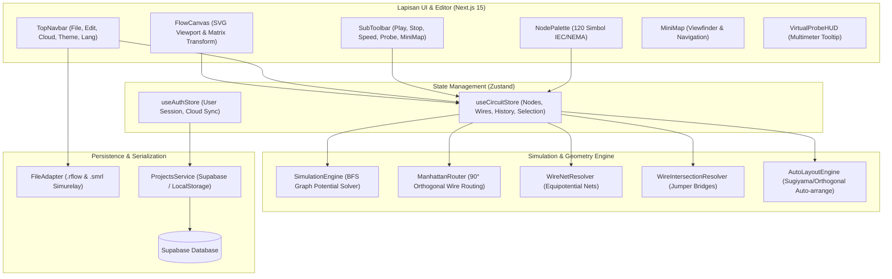

# Rangkuman Studi Arsitektur & Rencana Pengembangan RelayFlow

Dokumen ini memuat hasil pemetaan dan analisis menyeluruh terhadap codebase **RelayFlow**, mencakup arsitektur teknis, aliran data, komponen inti, status engine, serta opsi arah pengembangan berikutnya.

---

## 1. Executive Summary: Apa itu RelayFlow?

**RelayFlow** adalah simulator logika relay industri dan CAD skematik berbasis web berstandar industri (kompatibel penuh dengan standar visual dan format Simurelay). 

Aplikasi ini dibangun menggunakan:
- **Framework:** Next.js 15 (App Router), React 19, TypeScript
- **Styling:** Tailwind CSS v4, Lucide React
- **State Management:** Zustand v5 (dengan Undo/Redo history stack dan local storage hydration)
- **Database / Cloud:** Supabase (dengan in-memory / localStorage fallback untuk guest)
- **Testing:** Vitest (11 test suites, 76 unit/integration tests lulus 100%)

---

## 2. Peta Arsitektur Sistem (System Architecture)

---

## 3. Komponen Inti & Subsistem Utama

### 3.1. Engine Simulasi Listrik (`src/engine/SimulationEngine.ts`)
- **Topological Graph Solver**: Tidak menggunakan solver matriks SPICE analog yang lambat, melainkan algoritma propagasi potensial BFS diskrit iteratif yang sangat cepat (60 FPS stabil).
- **Multi-Potensial**:
  - DC: `+24V`, `-24V`
  - AC 3-Phase: `L1`, `L2`, `L3`, `N`, `PE`
- **Deteksi Urutan Fasa Motor 3-Fasa**: Mendeteksi arah putaran motor (CW / CCW) berdasarkan urutan fasa (misal: L1-L2-L3 = Searah Jarum Jam; pembalikan dua fasa L1-L3-L2 = Berlawanan Jarum Jam).
- **Logika Relay & Kontak Terkopel**: Relasi tag antara koil kontaktor (`-KM1`) dengan kontak bantu (`NO`, `NC`) dan kontak utama secara otomatis membuka/menutup switch saat koil dialiri arus.
- **Deteksi Hubung Singkat (Short Circuit)**: Mendeteksi tabrakan potensial fasa ke fasa atau fasa ke netral/ground.
- **Relay Pewaktu (Timer Relays)**: On-Delay, Off-Delay, Flasher, dan Latching.

### 3.2. Canvas Grafis & Router Kabel Ortogonal (`src/engine/router/`)
- **Pure SVG Canvas**: Rendering langsung elemen SVG tanpa perantara canvas bitmap, sehingga hasil zoom tajam dan siap diekspor ke SVG/PDF vektor.
- **Manhattan Router**: Menghasilkan rute kabel 90° rapi dengan pengaturan margin start/center/end serta eliminasi titik kolinear.
- **Bridge Jumper Visual**: Mengidentifikasi persilangan kabel dan menggambar lengkungan jumper (*wire crossing bridge*) agar skema tidak ambigu.
- **Snap 30px & Magnetic Terminals**: Snap posisi komponen dan terminal pada grid kelipatan 30px.

### 3.3. Katalog 120 Simbol Industri (`src/constants/components-catalog.json`)
- Simbol sakelar, push button (momentary & latching), kontaktor, timer, sensor, lampu indikator, overload relay, fuse, MCB 1P-4P, dan motor AC/DC.
- Multi-frame visual SVG (`SymbolRenderer.tsx`) yang merespons state simulasi secara visual (posisi armatur terbuka/tertutup, filamen menyala, motor berputar).

### 3.4. Dual Format Serializer (`src/engine/serializer/FileAdapter.ts`)
- **Format Asli**: `.rflow` (JSON murni terstruktur dengan metadata dan preferensi).
- **Format Kompatibilitas**: `.smrl` (Format legacy aplikasi desktop Simurelay, konversi dua arah mulus).

### 3.5. Autentikasi, Cloud Sharing & Viewer Mode (`/c/[id]`)
- Mendukung mode Guest (local-first dengan `localStorage`).
- Mode Cloud dengan Supabase untuk sinkronisasi proyek.
- Tautan Publik (`/c/[id]`): Menampilkan sirkuit dalam mode Read-Only dengan kemampuan interaksi simulasi penuh (pengunjung bisa menekan tombol dan melihat simulator berjalan), plus opsi **"Fork to Edit"**.

---

## 4. Status Pengujian (Test Suite)

Proyek ini telah memiliki cakupan pengujian unit & integrasi otomatis yang lengkap menggunakan Vitest:
- `tests/engine.test.ts` (13 tests) — Logika simulasi, short circuit, timer, motor 3 fasa
- `tests/serializer.test.ts` (3 tests) — Parse & export .rflow dan .smrl
- `tests/wire-manipulation.test.ts` (13 tests) — Splice, branch, connect, disconnect
- `tests/popover-actions.test.ts` (14 tests) — Rotasi, tag, comment, color, timer values
- `tests/wire-intersections.test.ts` (4 tests) — Deteksi crossing kabel & bridge jumper
- `tests/wire-labeling.test.ts` (6 tests) — Wire numbering & tagging
- `tests/cloud-and-viewer.test.ts` (9 tests) — Mock cloud service, viewer mode, fork logic
- `tests/canvas-performance.test.ts` (2 tests) — Benchmark performa
- `tests/circular-symbols.test.ts` (6 tests) — Simbol rotasi & pin mapping
- `tests/autolayout.test.ts` (1 test) — Algoritma tata letak otomatis
- `tests/summary.test.ts` (5 tests) — Ekstraksi BOM (Bill of Materials) & wire count

**Hasil:** `11 passed (11 files), 76 passed (76 tests)`.

---

## 5. Rencana & Opsi Pengembangan Berikutnya

Berdasarkan arsitektur yang ada, berikut beberapa fokus lanjutan yang dapat kita kerjakan:

1. **Fitur Ekspor Tambahan:**
   - Ekspor skematik langsung ke format SVG Vektor standalone atau file PDF berukuran lembar standar (A3/A4 CAD border).
   - Ekspor Bill of Materials (BOM) / Daftar Komponen ke file CSV/Excel.

2. **Penyempurnaan Simulasi & Komponen:**
   - Komponen PLC sederhana (Ladder Logic interpreter atau blok input/output dasar).
   - Pengukuran arus/beban dinamis (amperemeter interaktif).

3. **Peningkatan Pengalaman Canvas & UX:**
   - Keyboard shortcut customization.
   - Peningkatan visual snap guidelines & magnetic alignment.
   - Penambahan library contoh rangkaian siap pakai (Star-Delta Starter, ATS Generator, Reverse-Forward Interlock).

4. **Kebutuhan Khusus Pengguna:**
   - Silakan beri tahu jika ada modul, fitur, atau perbaikan bug tertentu yang ingin Anda fokuskan!
